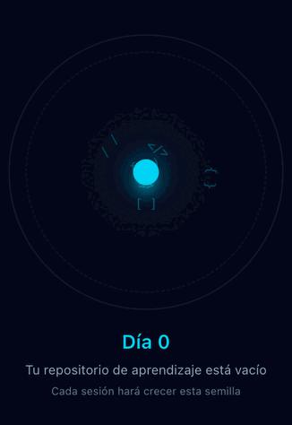
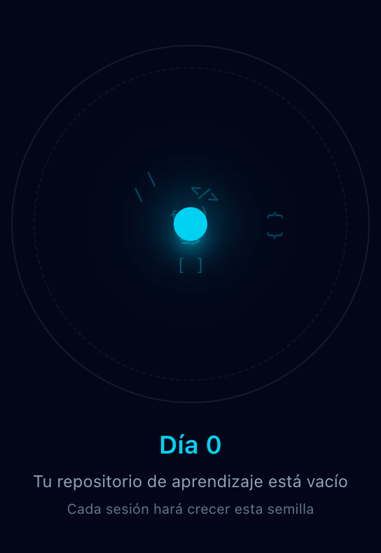
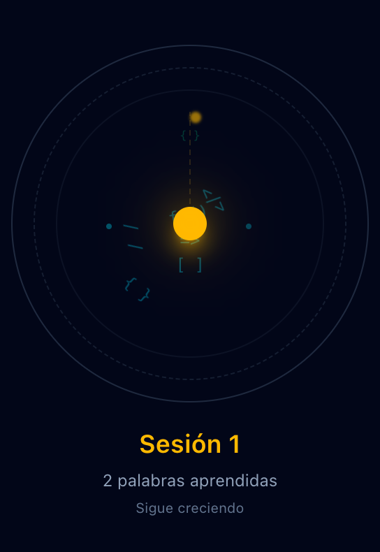
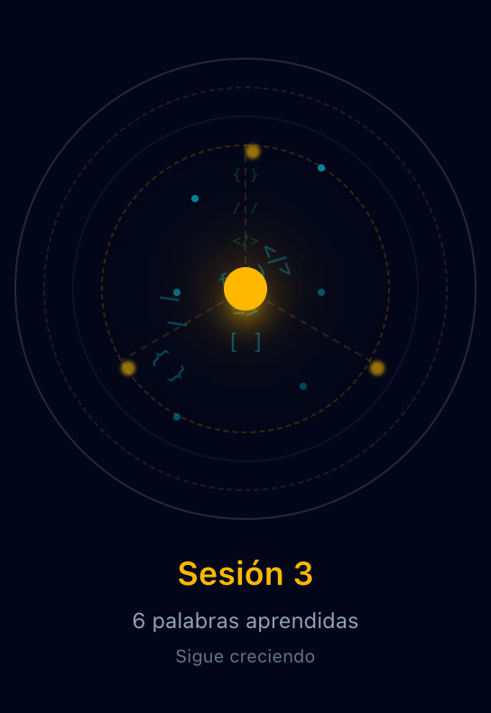
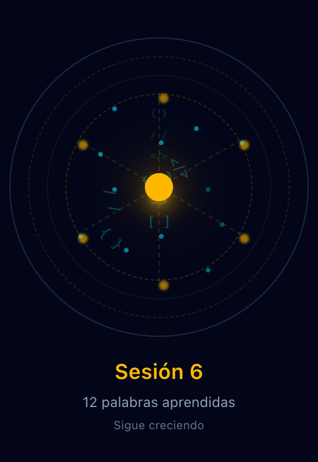
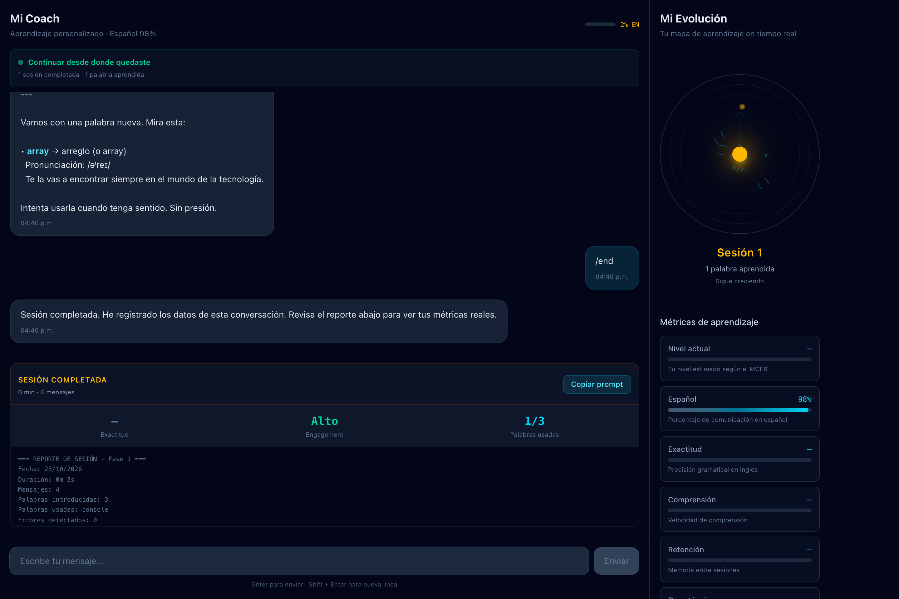

# Kelvin English

Coach personal de inglés para profesionales tech hispanohablantes. En lugar de enseñar de forma genérica, observa cómo aprendes y muestra tu progreso real, sin puntajes inflados.

> **Estado:** etapa temprana. El coach funciona con reglas fijas (todavía sin IA) y los datos se guardan solo en tu navegador. Hoy lo usa su autor como primer usuario real; la meta es que sirva a cualquier profesional de tecnología.

## Así crece tu avance

<p align="center">
  
</p>

Tu progreso se ve como una semilla rodeada de símbolos de código que orbitan. Cada parte responde a datos reales:

| Día 0 | Sesión 1 | Sesión 3 | Sesión 6 |
| :---: | :---: | :---: | :---: |
|  |  |  |  |
| Repositorio vacío | Primera sesión | Aparece el anillo ámbar | Crecimiento máximo |

- **Color:** la semilla empieza cian y se vuelve ámbar con tu primera sesión completada.
- **Nodos:** cada sesión agrega un nodo conectado al centro, hasta 6.
- **Partículas:** cada palabra en inglés que usas de verdad agrega una partícula, hasta 12.
- **Anillos y órbitas:** con 3 sesiones aparece un anillo ámbar; con más sesiones hay más símbolos y giran más rápido.

Si no hay avance, la semilla no crece: refleja tu progreso, no lo adorna.

<p align="center">
  
</p>

<sub>Imágenes generadas con datos de ejemplo. Las métricas que aún no se miden aparecen como «—».</sub>

## Qué hace

La app tiene dos paneles siempre visibles:

- **Coach:** una conversación en español que hace un diagnóstico breve (sin parecer examen) y luego abre sesiones de aprendizaje. En cada sesión introduce vocabulario en inglés útil para trabajar en tecnología: palabras como `function`, `commit` o `debug`, con su traducción y pronunciación.
- **Evolución:** una semilla que crece con tus sesiones y un panel de métricas.

Al cerrar cada sesión (botón **Terminar**, comando `/end` o 3 minutos de inactividad) genera un reporte y un **prompt de continuidad** con tu perfil y métricas, para seguir evolucionando la app con esa información.

## Principios

- **Progreso honesto.** Una métrica que todavía no se mide se muestra como `—`, no como un porcentaje inventado. Si retrocedes, el panel lo muestra.
- **Feedback tipo code review**, no calificaciones.
- **Inglés gradual.** Se asume nivel cero y todo empieza en español; el inglés entra palabra por palabra.
- **Tus datos son la fuente de verdad.** La app nunca borra tu progreso sin tu confirmación explícita.

## Stack

- [Next.js 15](https://nextjs.org) (App Router) + React 19
- TypeScript
- Tailwind CSS v4
- `localStorage` para persistencia (sin backend por ahora)

## Cómo correrlo

Requisitos: Node.js 18.18 o superior.

```bash
git clone https://github.com/KelvinLB/kelvin-english.git
cd kelvin-english
npm install
npm run dev
```

Abre <http://localhost:3100>. El puerto está fijo porque `localStorage` depende del origen: si la app corre en otro puerto, empieza sin datos.

| Comando         | Qué hace                              |
| --------------- | ------------------------------------- |
| `npm run dev`   | Servidor de desarrollo en el puerto 3100 |
| `npm run build` | Build de producción                   |
| `npm start`     | Sirve el build en el puerto 3100      |

## Estructura

```
app/
├── page.tsx                 # Layout de dos paneles (tabs en móvil)
├── hooks/useCoach.ts        # Orquestador: diagnóstico, sesiones y persistencia
├── lib/                     # Lógica pura, sin JSX
│   ├── coach-data.ts        # Respuestas del coach, análisis de mensajes y prompts
│   ├── session-analyzer.ts  # Reporte y métricas al cerrar una sesión
│   ├── storage.ts           # Lectura y escritura en localStorage
│   ├── constants.ts         # Preguntas, vocabulario y configuración
│   └── types.ts
└── components/
    ├── coach/               # Chat, reporte de sesión y prompt de continuidad
    └── evolution/           # Semilla y métricas
```

## Datos

Todo vive en el `localStorage` del navegador, bajo claves con el prefijo `kelvin-english-`:

| Clave              | Contenido                                   |
| ------------------ | ------------------------------------------- |
| `profile`          | Perfil, métricas e historial de sesiones    |
| `messages`         | Conversación con el coach                   |
| `coach-state`      | Fase actual y avance del diagnóstico        |
| `active-session`   | Sesión en curso, si hay una                 |
| `words-introduced` | Palabras introducidas en la sesión actual   |
| `last-report`      | Reporte de la última sesión cerrada         |

Para empezar de cero, usa **Reiniciar progreso** al final del panel Evolución. Pide confirmación antes de borrar.

## Hoja de ruta

- **Fase 2:** base de datos real, cuentas y sesiones en varios dispositivos.
- **Fase 3:** IA para conversación real y análisis de errores.
- **Fase 4:** ejercicios interactivos y práctica deliberada.
- **Fase 5:** comunidad y rachas opcionales.

Las reglas de diseño y de producto están en [`AGENTS.md`](AGENTS.md).
